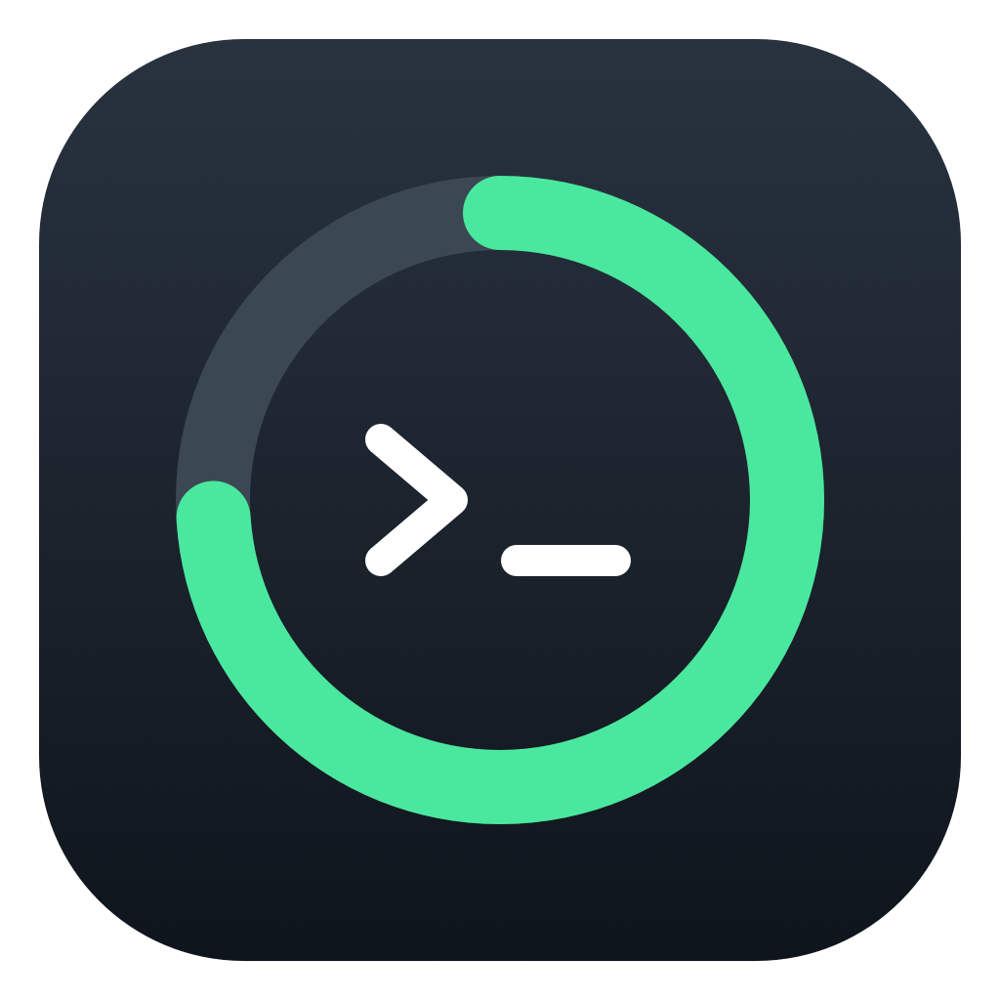
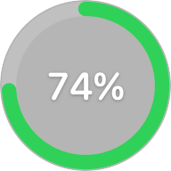
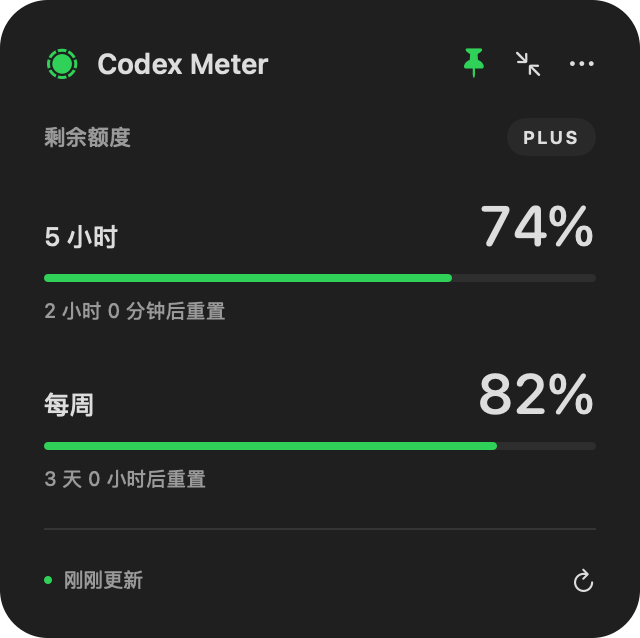
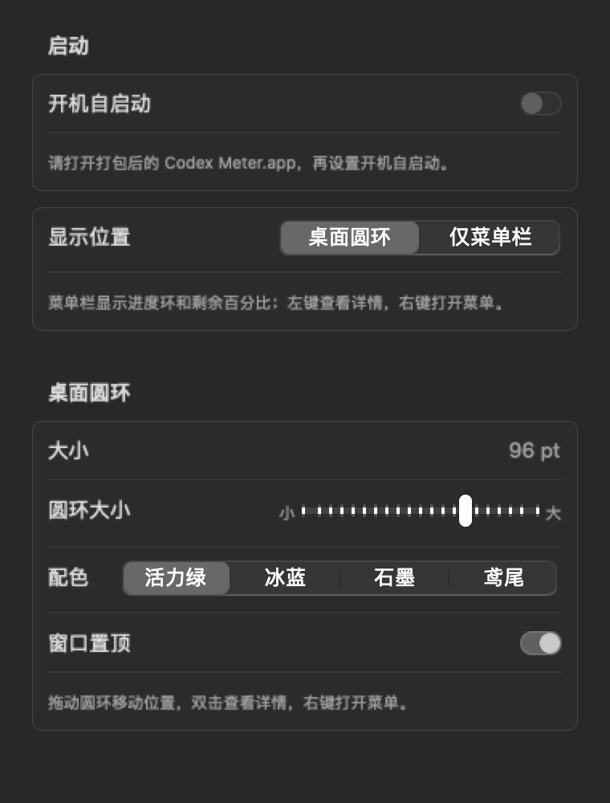

<p align="center"></p>

# Codex Meter

原生 macOS Codex 剩余额度悬浮窗。一眼查看剩余额度，也可以只在菜单栏显示一个数字。

Swift + SwiftUI + AppKit，无第三方运行时依赖、无 WebView、无需后端。独立社区工具，与 OpenAI 无隶属关系。

[English](README.en.md) · [下载 / Releases](https://github.com/lys1313013/codex-meter/releases) · [常见问题](#常见问题) · [贡献指南](CONTRIBUTING.md) · [MIT License](LICENSE)

## 界面预览

| 桌面圆环 | 额度详情 | 菜单栏数字 |
| :---: | :---: | :---: |
|  |  |  |

预览使用固定示例数据。圆环和详情来自应用视图的离屏渲染，详情使用纯色底以便阅读；菜单栏为相同数字格式和字号的示意。运行时的玻璃、透明度和字体效果随系统环境变化。

<details>
<summary>外观与大小设置</summary>
<p></p>
</details>

## 功能

- 可拖动、置顶的桌面悬浮窗，支持其他桌面和全屏工作区。
- 桌面圆环 / 仅菜单栏两种显示位置；菜单栏仅显示剩余百分比数字。
- 剩余额度、低额度颜色提示、重置倒计时；多个额度窗口取剩余比例最低的一个作为圆环和菜单栏指标。
- 圆环默认直径 56pt，可调为 40–120pt；支持活力绿、冰蓝、石墨、鸢尾配色，自动记忆偏好和位置。
- 每轮刷新完成后约 2 分钟再次刷新，支持手动刷新和唤醒后刷新。
- 设置中可开启或关闭开机自启动，登录 Mac 后自动运行，状态与系统登录项同步。
- 支持多个额度分组，按真实窗口时长显示，不假定一定同时存在 5 小时和每周限制。
- 读取失败时保留上次结果并标记旧数据，不把未知值显示为满额。
- macOS 26+ 展开面板使用原生 Liquid Glass，旧系统使用普通材质。

## 系统与账号要求

| 项目 | 要求 / 验证范围 |
| --- | --- |
| 应用最低系统声明 | macOS 13 Ventura；旧系统运行情况仍需设备验证 |
| 首发预编译包 | Apple Silicon（`arm64`） |
| Intel | 可尝试源码构建；尚未完成 Intel 实机验证，不承诺首发支持 |
| 源码构建 | Swift 6 工具链，macOS 26+ SDK（Xcode 26+ 或对应 Command Line Tools） |
| 本地已验证 | macOS 27.2 / Apple Silicon / Swift 6.4 / macOS 27 SDK 的检查、构建和打包 |
| CI 配置 | `macos-15` + Xcode 26.2，生成 `arm64` 包；以 GitHub Actions 实际运行结果为准 |
| 账号 | 本机 Codex 已使用 ChatGPT 账号登录，且服务返回订阅额度 |

API Key 登录不提供这里展示的 ChatGPT 订阅额度。Codex 桌面版、ChatGPT 内置 CLI 或独立 Codex CLI 均可作为来源，具体取决于本机安装版本。

## 安装

### 下载应用

本项目提供免费的 ZIP 安装包，安装和使用无需购买 Apple 开发者会员。当前预编译包适用于 Apple Silicon（`arm64`），采用 ad-hoc 临时签名，未经 Apple 公证；首次打开可能需要手动允许。

1. 在本仓库的 [Releases](https://github.com/lys1313013/codex-meter/releases) 页面下载 `Codex-Meter-<版本>-macos-arm64-adhoc.zip` 和同名 `.sha256` 文件；`Source code` 是源码压缩包，不是应用安装包。
2. 将两个文件放在同一目录，在终端进入该目录并运行下面的命令核对 SHA-256。以 `0.1.0` 为例，成功时显示 `OK`：

   ```bash
   shasum -a 256 -c Codex-Meter-0.1.0-macos-arm64-adhoc.zip.sha256
   ```

3. 双击 ZIP 解压，将 `Codex Meter.app` 拖入「应用程序」（Applications）文件夹。
4. 从「应用程序」中打开 `Codex Meter.app`。如果 macOS 提示无法验证应用，按下一节操作。

### 首次打开被 macOS 阻止时

以下步骤适用于你已确认从本仓库 Releases 下载、校验通过的安装包：

1. 在「未打开 Codex Meter」或「Apple 无法验证」的提示中点击「完成」（或关闭提示）。
2. 打开「系统设置」→「隐私与安全性」，向下滚动到「安全性」，找到 Codex Meter 被阻止的提示。
3. 点击「仍要打开」（英文系统为 `Open Anyway`），在后续提示中确认「打开」，并按要求使用密码或 Touch ID 授权。
4. macOS 会为该应用保存例外，之后通常可以直接打开。

如果没有看到「仍要打开」，先从「应用程序」再次尝试打开该应用，再返回「隐私与安全性」查看。具体按钮名称可能随 macOS 版本略有差异，参见 [Apple 官方打开步骤](https://support.apple.com/zh-cn/102445)。

### 从源码构建

```bash
git clone https://github.com/lys1313013/codex-meter.git
cd codex-meter
./scripts/build-app.sh
open "dist/Codex Meter.app"
```

构建脚本默认使用当前机器架构，移除调试符号并检查本机路径残留，再进行 ad-hoc 签名和校验。若提示 SDK 过旧，用 `xcrun --sdk macosx --show-sdk-version` 和 `xcode-select -p` 检查当前选择的开发工具。构建系统要求与应用最低运行系统是两回事。

## 操作

- 拖动圆环移动位置；双击展开；右键打开菜单。
- 展开面板可拖动标题或额度区域；图钉切换置顶，收缩按钮恢复圆环，刷新按钮立即更新。
- 菜单中选择「仅菜单栏数字」隐藏桌面窗口，选择「桌面圆环」恢复。数字 `74` 表示剩余 74%；未知或旧数据显示 `--`。
- 「外观与大小…」设置圆环直径、配色和显示位置；也可用 `⌘,` 打开设置。
- 设置 →「启动」→「开机自启动」控制登录时自动打开；如需系统允许，点击「打开系统登录项设置…」。此功能需要运行打包后的 `.app`，建议先放入 Applications；`swift run` 调试运行时开关不可用。
- 多个额度分组可在展开面板中选择；悬停可查看窗口名称和重置时间。
- 自动查找 Codex / ChatGPT 应用内 CLI、Homebrew 和 PATH 中的 `codex`；自定义位置可通过「选择 Codex CLI…」设置。

## 常见问题

**提示找不到 Codex？**

先确认已安装 Codex。Finder 启动的应用与终端的 PATH 可能不同，尤其是通过版本管理器安装 CLI 时。可在终端用 `command -v codex` 找到可执行文件，再从应用菜单选择该文件。恢复自动查找时选择「自动查找 Codex CLI」。

**已登录但没有额度，或与预期账号不一致？**

确认应用选中的 Codex 使用 ChatGPT 账号登录。自动查找优先使用应用内 CLI，可能与终端中运行的 CLI 不同。API Key 登录和服务没有返回额度窗口的情况不会显示订阅额度；更新 Codex 后可再次刷新。不要上传 `auth.json` 来排查。

**为什么只有每周额度，没有 5 小时额度？**

只展示服务实际返回的窗口。`primary` 不一定代表 5 小时，应用按 `windowDurationMins` 标注；缺失窗口不会补造。

**显示旧数据、橙色提示或 `--`？**

请求失败或最近一次成功更新距今超过 5 分钟时，数据会标为旧数据。检查网络和登录状态后手动刷新；单次读取超时约 20 秒。圆环保留旧比例并给出提示，菜单栏显示 `--`，避免把旧值当成实时值。

**倒计时结束为什么没有恢复到 100%？**

应用等待服务返回新额度，不依据本地时钟推测额度已恢复。下一次刷新后会显示服务提供的值。

**下载后被系统阻止打开？**

当前免费 ZIP 采用临时签名，未经 Apple 公证。对于从本仓库 Releases 下载并校验通过的包，按[首次打开被 macOS 阻止时](#首次打开被-macos-阻止时)的步骤，在「系统设置」→「隐私与安全性」中点击「仍要打开」。安装和使用无需付费开发者账号。

**如何卸载和清理设置？**

先在设置中关闭开机自启动，从菜单退出，再从 Applications 删除 `Codex Meter.app`。如需同时移除偏好，退出后执行：

```bash
defaults delete io.github.lys1313013.codex-meter
```

这会清除打包应用的窗口位置、配色、显示模式和自定义 CLI 路径。开机自启动由 macOS 登录项管理。开发时通过 `swift run` 运行的程序可能使用不同的偏好域。

## 数据来源与隐私

每次刷新启动短生命周期的 `codex app-server`，完成 `initialize` / `initialized` 握手后调用 `account/rateLimits/read`，读取完成后退出子进程。Codex Meter 不创建对话、不发起模型生成、不读取或复制 `auth.json`；认证与相关网络访问由本机 Codex 处理。

- 应用不接入分析或遥测服务，不保存额度历史。
- 打包应用的偏好保存在 `io.github.lys1313013.codex-meter` 的 UserDefaults 中，包括显示设置、窗口位置和自定义 CLI 路径。开机自启动由系统登录项管理。
- 优先采用 `rateLimitsByLimitId`，旧版本回退 `rateLimits`；剩余比例为 `100 - usedPercent`，限制在 0–100。
- `--check` 只输出额度分组、窗口、剩余比例和重置时间，不输出账号、凭据或完整服务响应。
- 展示图使用合成数据，生成过程不启动 Codex、不访问账号，也不改动正常应用的偏好。

参考 [OpenAI Codex App Server 文档](https://learn.chatgpt.com/docs/app-server#6-rate-limits-chatgpt)。接口会随 Codex 版本演进，后续可能需要适配。

## 开发与验证

```bash
./scripts/verify.sh                               # 离线检查、Release 构建、ZIP 和校验值
swift run CodexMeter                              # 开发运行
swift run MeterChecks                             # 不需要 Codex 账号的自动检查
swift run CodexMeter --check                       # 可选：检查本机真实额度接口
swift run CodexMeter --render-previews docs/images # 重生成示例预览
./scripts/generate-icon.swift                     # 重生成原创图标
```

检查使用独立 Swift 可执行目标，无需 XCTest runner；CI 执行 `MeterChecks`，不读取真实账号。发布步骤与签名配置见 [发布指南](docs/RELEASING.md)，版本变化见 [CHANGELOG](CHANGELOG.md)。

## 界面材质

紧凑圆环使用同一路径上的进度与轨道，半透明背景保持数字和进度清晰；系统开启“降低透明度”时使用完整材质。展开面板在 macOS 26+ 使用 [NSGlassEffectView](https://developer.apple.com/documentation/appkit/nsglasseffectview) 和系统语义文字色，macOS 13–25 回退普通材质。

## 许可证

[MIT](LICENSE) © 2026 lys1313013。源码、原创图标及示例展示图均随本项目按 MIT 许可证提供。
